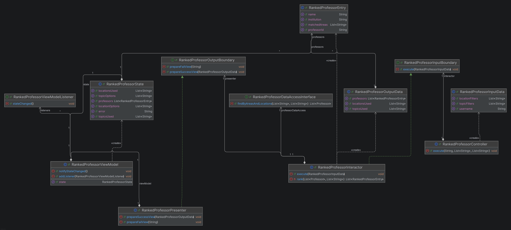
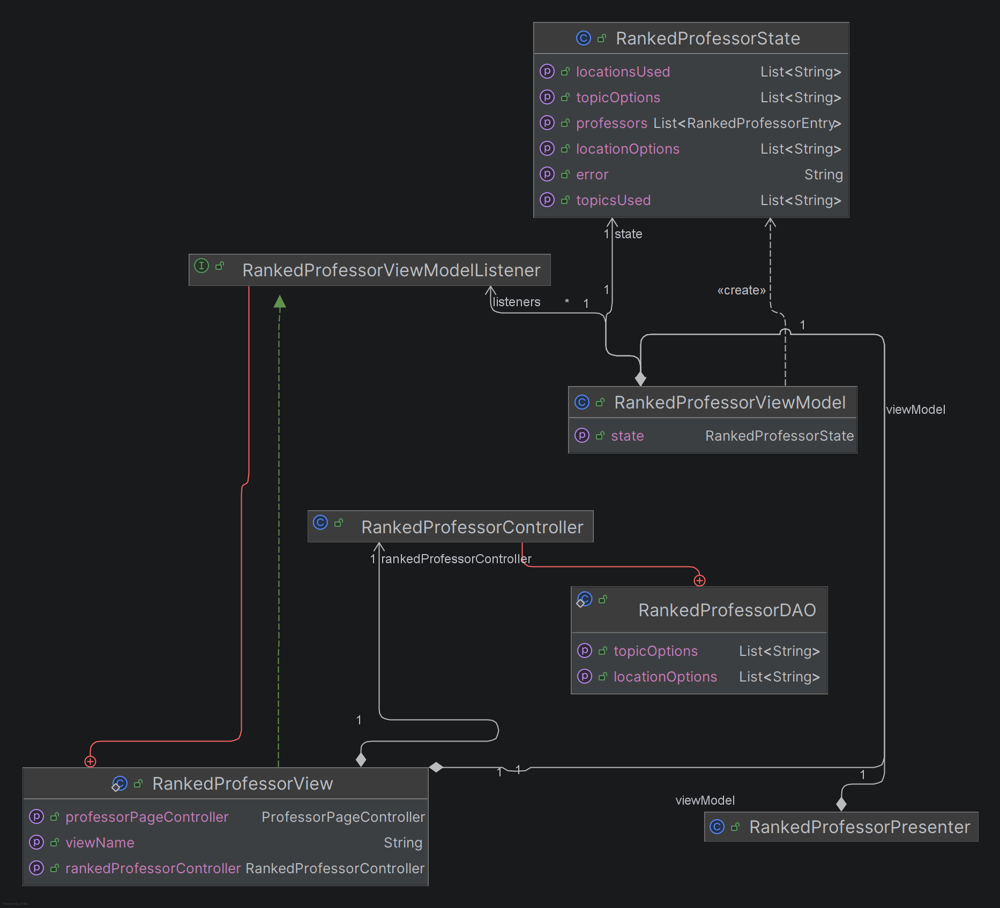

# CS Research Finder
## Team Information
### Team Members
- Nabiha Tariq
- Yusyra Hossain
- Iman Imran
- Dana Younes
- Jasmine Bui
---

## Project Description
CS Research Finder helps students find computer science research opportunities. Users can browse professors by their research area/topic and locations and view their current works. Users can create an account to track which professors they have reached out through the contact information available on the professor page. Tentatively cold email template and summaries. 

### Walkthrough 
First user signs in or signs up with their information and areas of interest. Then, we get a landing page with a two search filters on location and topics. After loging in, the platform will recommend one research paper based on the user's profile interests. User selects what they want, searches, and gets a list of professors who have research in those areas. The user will then click on professor names to find research papers of interest. In the professor profile, there will be contact information for the user to cold email. Once the user has contacted the professor, they will click a button to signal they've contacted the professor and that is stored in the database. On each professor profile, there will be a cold email template personalized for each user that relates to the professor's work and the user's interest.

The scope of the project will be institutions in Canada, mainly in the GTA and other larger institutions across Canada.

---
## User Stories
### As a user, I want to be able to create an account and login with my interests so that I can receive personalized research papers and cold emails. 
### As a user, I want to be able to receive a ranked list of professors who match my research interests and preferred location/institution (either from my profile, or from the filters I adjust), so that I know who I can contact for opportunities.
### As a user, I want to see the research papers I’ve saved and the professors I’ve contacted on my profile page, so that I can easily return to the work I’m interested in and keep track of who I’ve already reached out to
### As a user, I want to be able to receive a recommended research paper that is catered to my interests so that I can explore this area more.
### As a user, I want to be able to click on a professor name and be shown all research papers a professor has published so that I can click through relevent papers and track if I've contacted said professor.
### As a user, I want to be able to receive a cold email template while I’m visiting a professor page that is personalized with my interests and the professor’s area of research.
---
## Use Cases
### Use Case 1: Signing up/Creating an account 
#### Primary Actor:
User 
#### Preconditions:
- User has access to the application
- User doesn't have an account if attempting to create a new account
#### Trigger:
The user clicks on a button to create an account or a button to login
#### Success Outcome:
- User has successfully created an account or has logged into the application, launching a home page on application
- Unsuccessful login or creation of account will lead to a popup error message prompting user to try again
- User's interests and information are saved to database
#### Main Success Scenario:
1. User opens application
2. User selects option to create an account
3. System prompts user to enter their preferred usename and password
4. System gives them a list of options to choose from for preferred interests and institutions
5. User clicks submit button
6. System validates submitted information to ensure no errors
7. System creates user account and saves information to database
8. System displays message that account was created successfully
9. User logs in with their account name and password
10. System verifies the password and grants access to application
11. System launches home page where user can view a personalized paper, personalized suggestions for professors to contact, and filter bar.
#### Extensions:
##### 4a: User leaves fields empty
1. System will display message with fields that still need to filled out by user
2. Use case continues at step 4
##### 5b: Username entered is already in database
1. System will inform user that they already have an account
2. System will prompt user to login
3. Use case continues at step 8
##### 8a: User enters wrong credentials
1. System displays message that credentials are incorrect 
2. System prompts user to reenter credentials
3. Use case continues at step 8

### Use Case 2: View a Ranked List of Matching Professors
#### Primary Actor: 
User that already has an account
#### Preconditions: 
- The user is logged in.
- The user has just logged in, or has returned to the landing page while logged in.
- The user’s profile contains at least one research interest.
#### Trigger: 
The user arrives at the landing page while logged in.
#### Success Outcome: 
The user sees a list of professors ordered from best match to weakest match, based on their profile OR adjusted filters.
#### Main success scenario: 
1. The user logs in, and arrives at the landing page.
2. The system finds professors whose research areas match the user’s interests (either from profile, or from the adjusted filters).
3. The system ranks the matching professors by how well they fit.
4. The system shows the ranked list, along with the criteria used and the location and topic filters. Each entry shows the professor’s name, institution, and the research areas that matched.
5. The user reviews the list.
6. The user changes the filters, and steps repeat from 2.
#### Extensions:
##### 2a. No professors match the user’s profile OR combination of filters.
1. The system tells the user that no matches were found.
2. The system suggests adding more interests/location, or changing filters.
3. The use case ends.
##### 4b. Many professors match.
1. The system shows the best matches first.
2. The user can ask to see more results.

### Use Case 3: Receiving a Recommended Paper
#### Primary Actor:
User
#### Preconditions:
- User is logged in.
#### Trigger:
The user arrives at the landing page after logging in.
#### Success Outcome:
- User sees one recommended paper picked for their interests, along with a short reason why it was picked
- The same paper stays as the recommendation for the rest of the day, and a new one shows up the next day
- The user's feedback on the paper is saved and used to improve future recommendations
- User can save the paper to their collection and revisit it later on
#### Main Success Scenario:
1. User logs in and arrives at the landing page.
2. System checks if the user already has a recommendation for today.
3. System gets recent papers from OpenAlex related to the user's interests.
4. System removes papers that were already recommended to the user before.
5. System scores each paper based on how well it matches the user's interests, how recent it is, and how many times it has been cited.
6. System picks the highest scoring paper and saves it to the database as today's recommendation.
7. System displays the paper's title, authors, year, abstract, a link to the full paper, and why it was picked (ex. "Matches your interest in robotics · Published this year · Highly cited").
8. User clicks the bookmark icon to save the paper.
9. System adds the paper to the user’s collection in the database, updates the bookmark icon and indicates "Added to collection"
10. System uses saved paper's topics to improve future recommendations.
11. User opens their profile and views their saved papers, ordered from most recently saved.
12. User selects a saved paper to view details again

#### Extensions:
##### 2a: User already has a recommendation for today
1. System loads the saved recommendation from the database.
2. Use case continues at step 7.
##### 3a: User has no research interests in their profile
1. System gets recent, highly cited papers instead.
2. System prompts the user to add interests to get personalized recommendations.
3. Use case continues at step 4.
##### 3b: OpenAlex is unavailable
1. System displays the user's most recent saved recommendation with the message "Couldn't load a new paper, here's your last one."
2. If there is no saved recommendation, system displays "Couldn't load a paper right now, please try again later."
3. Use case ends.
##### 4a: All papers found were already recommended before
1. System widens the search to related topics or slightly older papers.
2. Use case continues at step 5.
##### 7a: Paper has no abstract
1. System displays the title, authors, and link, with the message "No abstract available."
2. Use case continues at step 8.
##### 8a: User saves the paper
1. User clicks the bookmark icon to save the paper (see Use Case 4).
2. System also counts saving the paper as "More like this".
3. Use case continues at step 9.
##### 8b: User clicks on an author's name
1. System opens that professor's profile page.
2. Use case ends.

### Use Case 4: Clicking on professor page and action items on the page
#### Primary Actor:
User 
#### Preconditions:
- User has access to the application
- User has an account with preferences logged in
- Professor profiles and research publications are available in system
#### Trigger:
The user clicks on a professor name from the "Recommended Professors" filtering system on landing page.
#### Success Outcome:
- System displays relevant professors who may have research that's of interest to user and/or location preferrences.
- User can click on papers to be directed to the official publication page
- User can track who they've contacted on the page

#### Main Success Scenario:
1. User logs in
2. User toggles filters until they're satisfied with what professors are showing up
3. User clicks on a professor name from the professor list
4. System directs the user to the professor page
5. System fetches all relevant data to professor with name and publication and displays it
6. User clicks on a publication to read more about and is redirected to external research paper site
7. User updates professor contact status
8. System saves the contact status to user profile
9. System displays message that the action has gone through and contact status has been updated
10. User can return to home or continue searching papers from a professor
#### Extensions:
##### 3a: No publications
1. System displays message that no publications from the professor are available at the moment
2. User can return to home page and continue search
3. Use case ends
##### 6a: User clicks on research paper with no available link
1. System will display message with the error
2. User can return to home or continue looking through professor page
3. Use case continues at step 6
#### 7a: User has already marked this professor as contacted:
1. System shows the button as “Contacted” with the date, and asks whether the user wants to undo it
2. If the user clicks yes, the app removes the professor from the contacted list, and the use case continues at step 7 with the message “Removed from contacted professors”
3. If the user clicks no, use case continues at step 7
#### 7b: User clicks the contacted button by mistake
1. User clicks the “Contacted” button again to unmark it.
2. App asks for confirmation, then removes the professor from the list in the database
3. Use case continues at step 7

### Use Case 5: Generate a personalized cold email
#### Primary Actor:
User
#### Preconditions:
- User has access to the application
- User has an account with preferences logged in
- Professor profiles and research publications are available in system
#### Trigger:
The user visits a professor's profile page and clicks the "Generate Cold Email" button
#### Success Outcome:
- A personalized cold email that reflects the user's interests and the professor's research areas is generated and displayed
- The user can copy or edit the email for their own use
#### Main Success Scenario:
1. User visits a professor's profile page
2. System gets all relevant information of the professor (name, research areas, institution,...) and displays it
3. User clicks on the "Generate Cold Email" button
4. System gets all relevant information of the user (interests, institution)
5. System generates a personalized cold email template with a suitable subject, greeting, introduction of the user, expression of the user's interest and reference to the professor's works and closing
6. System displays the generated email to the user
7. User reviews and edits the generated as they need
8. User can copy the email for their own use or regenerate it
#### Extensions:
##### 4a: User has not provided their interests
1. System prompts the user to provide their interests
2. User enters the required information
3. Use case continues at step 5
##### 7a: User edits the generated template
1. User edits the generated template
2. System updates the modifications and displays accordingly
3. Use case continues at step 8
##### 8a: User click regenerate the email
1. User selects "Regenerate"
2. System regenerate a different email using the same information of the user and professor
3. Use case continues at step 6

### Use Case 6: Viewing My Profile
#### Primary Actor:
User
#### Preconditions:
- User has an account and is logged in
- User may or may not have saved any papers or contacted any professors yet
#### Trigger:
The user clicks on the "My Profile" button from the home page
#### Success Outcome:
- The profile page opens and shows the user's account information and research interests
- The page shows a list of the research papers the user has saved
- The page shows a list of the professors the user has contacted, along with the date and status (whether the professor has responded or not)
- If a list is empty, the page shows a helpful message instead of a blank space
- The user can click on a paper to view it, and on a professor to go to their profile page
#### Main Success Scenario:
1. User clicks on the "My Profile" button
2. System retrieves the user's account information and research interests from the database
3. System retrieves the list of research papers the user has saved
4. System retrieves the list of professors the user has contacted, with the date and status for each
5. System combines this information into a profile view
6. System displays the profile page with the user's interests, saved papers and contacted professors
7. User looks through the lists and clicks on a paper or a professor
8. System opens the paper, or that professor's profile page
#### Extensions:
##### 3a: User has not saved any research papers
1. System displays a message such as "You haven't saved any papers yet. Browse professors' work to start saving papers."
2. Use case continues at step 4
##### 4a: User has not contacted any professors
1. System displays a message such as "You haven't marked any professors as contacted yet."
2. Use case continues at step 5

## Minimal Viable Product (MVP) 
** Each use case corresponds to one user story. 
| Team Member | MVP Use Case |
|-------------|--------------|
| Nabiha | Use Case #4 - Professor Page + Use Case # -- - Saving Contacted Professors|
| Yusyra | Use Case #2 - Ranked List of Professors + Use Case #1 - Signing Up/Creating Account|
| Dana | Use Case #3 - Recommended Papers Systems + DAO for Login and Signup (read/write to JSON)|
| Jasmine | Use Case #5 - Cold Emailing + Use Case # -- - Logout|
| Iman | Use Case #6 - User System + Use Case # -- - Saving Contacted Professors|
---
## Entities
### User
Instances: username, password, research interests, location preferences
### Professor
Instances: id, name, institution, research areas, publications
### ResearchPaper
Instances: id, title, authors, year, abstract, url

### ContactedProfessor; Subclass of Professor
Instances: id, name, institution, ----
### PaperOfTheDay; Subclass of ResearchPaper: 
Instances: ----

---
## API Usage
### **API Name:** 
OpenAlex
### **Documentation:** 
https://help.openalex.org/api/llm-quick-reference/
### **Usage in program:**
We use OpenAlex as the source of all research data (professors, papers, and the topic and institution lists). 
Requests are made with OkHttp, responses are parsed with org.json, and every request is authenticated with a free API key read from `api_key.properties` (gitignored, never
committed to protect API key). All API calls live in the data access layer (`data_access/`), in classes defined in the use case layer.

**Ranked Professor**: `RankedProfessorDAO`
- `GET /subfields?filter=field.id:17` loads the Computer Science subfields, which are the research area checkboxes (also used by Signup).
- `GET /institutions?filter=country_code:CA,type:education&sort=cited_by_count:desc` loads the top Canadian universities, which are the location checkboxes (also used by Signup).
- `GET /authors?filter=topics.subfield.id:<ids>,last_known_institutions.id:<ids>&sort=cited_by_count:desc` finds professors matching the selected subfields and institutions (or all of Canada if no
  location is selected). `|` combines several values with "or". Each author's subfields become their research areas, and the interactor ranks them by how many selected areas they match.

**Professor page**: `ProfessDataObject`
- `GET /authors/{id}` loads one professor's name, institution and topics.
- `GET /works?filter=author.id:{id}` loads their publications.

**Paper of the Day**: `PaperSearchDataObject`
- `GET /works?search=<interest>&filter=from_publication_date:<date>&sort=cited_by_count:desc`
  finds recent papers for each of the user's interests. 

---
## Design Diagrams
All use cases follow CA, so their UML diagrams are mostly similar. Below is an example of the Ranked Professor Use Case (use case #2).
### UML Class Diagram
- #### Ranked Professors Use Case (Interface Adapters + Use Case Interactor):

- #### Ranked Professors Use Case (Interface Adapters + Framework&Drivers):

### Sequence Diagrams

---
## How to Run
[Instructions for running the program.]

---
## Notes
[Any additional project information.]
